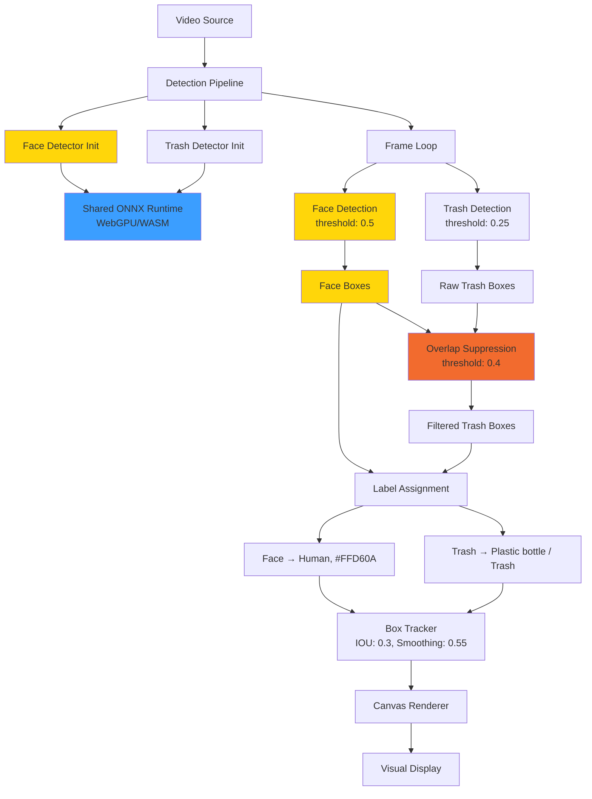
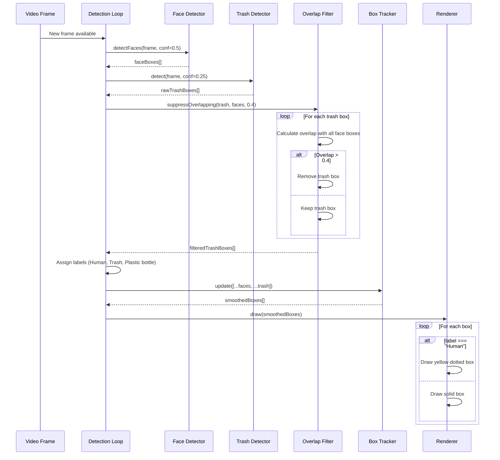
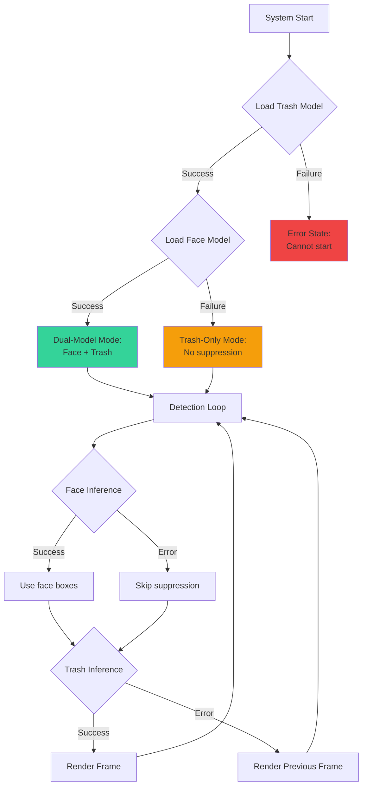

# Design Document: Face Detection Integration

## Overview

This design integrates a dedicated face detection model (`face-yolo.onnx`) into the existing trash detection pipeline to suppress false-positive trash detections that overlap with human faces. The integration follows a dual-model approach where both models run concurrently on every frame, with face detections used to filter trash detections before tracking and rendering.

### Key Design Decisions

1. **Dual-Model Architecture**: Run face detector alongside trash detector rather than replacing or modifying the trash model, preserving the existing trash detection accuracy while adding face suppression capability.

2. **Shared ONNX Runtime**: Reuse the existing `onnxruntime-web` instance and execution provider (WebGPU/WASM) across both models to minimize memory overhead and initialization time.

3. **Overlap-Based Suppression**: Use geometric overlap ratio (fraction of trash box covered by face box) rather than class confidence adjustment, providing deterministic suppression that doesn't require retraining or model modification.

4. **Visual Distinction**: Render face boxes with unique styling (yellow dotted line, "Human" label) to clearly distinguish people from trash objects in the operator interface.

5. **Graceful Degradation**: Continue trash detection even if face detector fails to load or encounters inference errors, ensuring core functionality remains available.

### Integration Points

- **WebcamDetect.jsx**: Main detection loop modification to run dual models
- **faceDetector.js**: Existing face detector module (already present, needs integration)
- **labels.js**: Extend canonical label dictionary to include "human"
- **track.js**: BoxTracker already supports multiple object types, no modification needed
- **Canvas rendering**: Add conditional styling based on label type

## Architecture

### System Components



### Data Flow Sequence



## Components and Interfaces

### 1. Face Detector Integration (WebcamDetect.jsx)

#### Modifications Required

**State Management**:
```javascript
const faceDetRef = useRef(null)  // Add face detector reference
```

**Initialization Phase** (within existing useEffect):
```javascript
useEffect(() => {
  let alive = true
  ;(async () => {
    try {
      // Existing trash detector initialization
      const d = await createDetector((m) => alive && setMsg(m))
      if (!alive) return d.dispose()
      detRef.current = d
      
      // NEW: Initialize face detector
      try {
        const { createFaceDetector } = await import('../lib/faceDetector')
        const fd = await createFaceDetector((m) => alive && setMsg(m))
        if (!alive) {
          fd.dispose()
          return
        }
        faceDetRef.current = fd
        setEp(`${d.ep}+face`)  // Update status to show dual models
        setMsg('Trash + face models ready — start detection')
      } catch (faceErr) {
        console.warn('Face detector unavailable:', faceErr)
        setMsg('Trash model ready (face detection disabled) — start detection')
      }
      
      setStatus('ready')
    } catch (e) {
      if (!alive) return
      setStatus('error')
      setMsg('Failed to load model: ' + (e?.message || e))
    }
  })()
  
  return () => {
    alive = false
    stop()
    detRef.current?.dispose()
    faceDetRef.current?.dispose()  // NEW: Cleanup face detector
  }
}, [])
```

**Detection Loop Modification**:
```javascript
async function detectLoop() {
  let frames = 0
  let t0 = performance.now()
  let taintWarned = false
  
  while (runningRef.current && detRef.current && srcElRef.current) {
    const tickStart = performance.now()
    
    // NEW: Run face detection first
    let faceBoxes = []
    if (faceDetRef.current) {
      try {
        faceBoxes = await faceDetRef.current.detectFaces(
          srcElRef.current, 
          { confThr: 0.5, iouThr: 0.3 }
        )
      } catch (faceErr) {
        console.warn('Face detection failed:', faceErr)
      }
    }
    
    // Existing trash detection
    let trashBoxes = []
    try {
      trashBoxes = await detRef.current.detect(
        srcElRef.current, 
        { confThr: confRef.current }
      )
    } catch (e) {
      if (!taintWarned && /tainted|cross-origin|SecurityError/i.test(e?.message || '')) {
        taintWarned = true
        setMsg('Drone stream blocked by CORS')
      }
    }
    
    // NEW: Suppress overlapping trash boxes
    const filteredTrash = suppressOverlapping(trashBoxes, faceBoxes, 0.4)
    
    // NEW: Label face boxes for display
    const labeledFaces = faceBoxes.map(b => ({
      ...b,
      label: 'Human',
      color: '#FFD60A',
      cls: 'human'
    }))
    
    // Combine and track all boxes
    const now = performance.now()
    const allBoxes = [...labeledFaces, ...filteredTrash]
    boxesRef.current = trackerRef.current.update(allBoxes, now)
    
    setCount(boxesRef.current.length)
    onCount && onCount(boxesRef.current.length)
    
    // FPS calculation (unchanged)
    frames++
    const elapsed = performance.now()
    if (elapsed - t0 > 600) {
      setFps(Math.round((frames * 1000) / (elapsed - t0)))
      frames = 0
      t0 = elapsed
    }
    
    await new Promise((r) => setTimeout(r, 0))
  }
}
```

**Overlap Suppression Function** (new utility):
```javascript
/**
 * Remove trash boxes that significantly overlap with face boxes.
 * Uses overlapRatio from detector.js to calculate coverage.
 */
function suppressOverlapping(trashBoxes, faceBoxes, threshold) {
  if (!faceBoxes || faceBoxes.length === 0) return trashBoxes
  
  return trashBoxes.filter(trash => {
    for (const face of faceBoxes) {
      const overlap = overlapRatio(trash, face)
      if (overlap > threshold) {
        return false  // Suppress this trash box
      }
    }
    return true  // Keep this trash box
  })
}
```

### 2. Label Dictionary Extension (labels.js)

**Modification**:
```javascript
export const CANON = {
  'plastic bottle': { label: 'Plastic bottle', color: '#22D3EE' },
  trash: { label: 'Trash', color: '#3B9EFF' },
  human: { label: 'Human', color: '#FFD60A' },  // NEW
}
```

**Note**: The `normalizeLabel` function does not need modification as face boxes are labeled directly in the detection loop, not through the trash detection filter pipeline.

### 3. Canvas Rendering Modification (WebcamDetect.jsx draw function)

**Current rendering logic** applies uniform styling to all boxes. The modification adds conditional styling based on label:

```javascript
function draw() {
  // ... existing setup code ...
  
  for (const b of boxesRef.current) {
    const col = b.color || ACCENT
    const isHuman = b.label === 'Human'
    const x = ox + b.x1 * scale
    const y = oy + b.y1 * scale
    const w = (b.x2 - b.x1) * scale
    const h = (b.y2 - b.y1) * scale

    // Box stroke (NEW: conditional dash pattern)
    ctx.strokeStyle = col
    ctx.lineWidth = 2
    if (isHuman) {
      ctx.setLineDash([5, 5])  // NEW: Dotted line for faces
    } else {
      ctx.setLineDash([])
    }
    ctx.shadowColor = col
    ctx.shadowBlur = 12
    ctx.strokeRect(x, y, w, h)
    ctx.shadowBlur = 0
    ctx.setLineDash([])  // Reset dash

    // Label rendering (unchanged logic, uses color from box)
    const label = b.label
    const tw = ctx.measureText(label).width + 16
    const thh = Math.max(22, cw / 30)
    const lx = x
    const ly = Math.max(0, y - thh)

    ctx.fillStyle = 'rgba(15, 23, 42, 0.6)'
    ctx.beginPath()
    ctx.roundRect(lx, ly, tw, thh, 6)
    ctx.fill()

    ctx.strokeStyle = 'rgba(255, 255, 255, 0.3)'
    ctx.lineWidth = 1
    ctx.stroke()

    ctx.fillStyle = '#fff'
    ctx.shadowColor = col
    ctx.shadowBlur = 4
    ctx.fillText(label, lx + 8, ly + 4)
    ctx.shadowBlur = 0
  }
}
```

### 4. Interface Contracts

#### Face Detector Interface (faceDetector.js)
```typescript
interface FaceDetector {
  detectFaces(
    source: HTMLVideoElement | HTMLImageElement,
    options?: { confThr?: number, iouThr?: number }
  ): Promise<FaceBox[]>
  
  dispose(): void
  ep: 'webgpu' | 'wasm'
}

interface FaceBox {
  x1: number  // Pixel coordinates
  y1: number
  x2: number
  y2: number
  score: number  // Confidence 0..1
}
```

#### Labeled Box Interface (extended)
```typescript
interface LabeledBox {
  x1: number
  y1: number
  x2: number
  y2: number
  score: number
  label: string  // Display text: "Human" | "Trash" | "Plastic bottle"
  color: string  // Hex color: "#FFD60A" | "#3B9EFF" | "#22D3EE"
  cls: string    // Canonical class: "human" | "trash" | "plastic bottle"
}
```

## Data Models

### Box Coordinate System

All detection boxes use pixel coordinates in source image space (video frame dimensions):

```javascript
{
  x1: number,  // Left edge (pixels)
  y1: number,  // Top edge (pixels)
  x2: number,  // Right edge (pixels)
  y2: number,  // Bottom edge (pixels)
}
```

**Invariant**: `x2 > x1` and `y2 > y1` (enforced by postprocessing in detector.js)

### Overlap Calculation

The `overlapRatio(a, b)` function computes the fraction of box `a` covered by box `b`:

```
overlap_ratio = intersection_area(a, b) / area(a)
```

**Range**: [0, 1]
- 0 = No overlap
- 1 = Box `a` completely contained within box `b`
- 0.4 threshold = Suppress if 40%+ of trash box overlaps face

**Example**:
```
Trash box: {x1: 100, y1: 100, x2: 200, y2: 200}  (10,000 px²)
Face box:  {x1: 150, y1: 150, x2: 250, y2: 250}  (10,000 px²)

Intersection: {x1: 150, y1: 150, x2: 200, y2: 200}  (2,500 px²)
overlapRatio(trash, face) = 2,500 / 10,000 = 0.25 (< 0.4, keep)
```

### Tracker State

The BoxTracker maintains temporal state for each tracked object:

```javascript
{
  x1: number,      // Smoothed position
  y1: number,
  x2: number,
  y2: number,
  score: number,   // Most recent confidence
  label: string,   // Most recent label
  color: string,   // Most recent color
  lastSeen: number // performance.now() timestamp
}
```

**Smoothing formula** (exponential moving average):
```
new_position = old_position * (1 - α) + observed_position * α
```
where α = 0.55 (weight given to new observation)

## Error Handling

### Error Categories and Recovery

| Error Type | Detection Point | Recovery Strategy | User Impact |
|------------|----------------|-------------------|-------------|
| Face model load failure | Initialization | Log warning, continue with trash-only | Status message: "Trash model ready (face detection disabled)" |
| Face inference error | Per-frame loop | Log error, skip suppression, render all trash boxes | None (trash detection continues) |
| CORS/tainted canvas | Frame capture | Show warning once, continue detection | Warning message displayed |
| Trash model load failure | Initialization | Set error status, halt detection | Error state, cannot start |
| Trash inference error | Per-frame loop | Log error, render previous frame boxes | Stale data, FPS continues |

### Graceful Degradation Flow



### Error Logging Strategy

**Console errors** (not displayed to user):
- Face model load failure: `console.warn('Face detector unavailable:', error)`
- Face inference error: `console.warn('Face detection failed:', error)`
- Trash inference error: Already handled with taint detection

**User-facing messages** (status pill):
- Initialization: "Loading AI models…"
- Face unavailable: "Trash model ready (face detection disabled) — start detection"
- Both ready: "Trash + face models ready — start detection"
- Running: "AI LIVE · {fps} fps · {count} found · LOCAL·GPU+face"

## Testing Strategy

### Unit Tests

**Pure functions to test**:

1. **Overlap suppression logic**:
   ```javascript
   describe('suppressOverlapping', () => {
     test('removes trash box with 50% overlap', () => {
       const trash = [{x1: 100, y1: 100, x2: 200, y2: 200, label: 'Trash'}]
       const faces = [{x1: 150, y1: 150, x2: 250, y2: 250}]
       const result = suppressOverlapping(trash, faces, 0.4)
       expect(result).toHaveLength(0)
     })
     
     test('keeps trash box with 30% overlap', () => {
       const trash = [{x1: 100, y1: 100, x2: 200, y2: 200, label: 'Trash'}]
       const faces = [{x1: 170, y1: 170, x2: 250, y2: 250}]
       const result = suppressOverlapping(trash, faces, 0.4)
       expect(result).toHaveLength(1)
     })
     
     test('handles empty face array', () => {
       const trash = [{x1: 100, y1: 100, x2: 200, y2: 200, label: 'Trash'}]
       const result = suppressOverlapping(trash, [], 0.4)
       expect(result).toEqual(trash)
     })
   })
   ```

2. **Label assignment**:
   ```javascript
   describe('face label assignment', () => {
     test('assigns Human label and yellow color', () => {
       const faceBox = {x1: 10, y1: 10, x2: 50, y2: 50, score: 0.95}
       const labeled = labelFaceBox(faceBox)
       expect(labeled.label).toBe('Human')
       expect(labeled.color).toBe('#FFD60A')
       expect(labeled.cls).toBe('human')
     })
   })
   ```

3. **CANON dictionary**:
   ```javascript
   describe('CANON labels', () => {
     test('includes human entry', () => {
       expect(CANON.human).toEqual({
         label: 'Human',
         color: '#FFD60A'
       })
     })
   })
   ```

### Integration Tests

**Mock-based integration tests** (using jest + canvas mock):

1. **Dual-model initialization**:
   ```javascript
   test('loads both models successfully', async () => {
     const component = render(<WebcamDetect />)
     await waitFor(() => {
       expect(screen.getByText(/Trash \+ face models ready/)).toBeInTheDocument()
     })
   })
   
   test('continues with trash-only if face fails', async () => {
     jest.spyOn(console, 'warn').mockImplementation()
     mockFaceDetectorError()
     const component = render(<WebcamDetect />)
     await waitFor(() => {
       expect(screen.getByText(/face detection disabled/)).toBeInTheDocument()
     })
   })
   ```

2. **Detection pipeline with mock frames**:
   ```javascript
   test('suppresses trash overlapping face', async () => {
     const mockFaceDetector = {
       detectFaces: jest.fn().mockResolvedValue([
         {x1: 100, y1: 100, x2: 200, y2: 200, score: 0.9}
       ])
     }
     const mockTrashDetector = {
       detect: jest.fn().mockResolvedValue([
         {x1: 110, y1: 110, x2: 190, y2: 190, label: 'Trash', color: '#3B9EFF'}
       ])
     }
     
     const component = render(<WebcamDetect />)
     // ... setup and trigger detection ...
     
     await waitFor(() => {
       // Trash box should be suppressed, only face shown
       expect(component.getByText('Human')).toBeInTheDocument()
       expect(component.queryByText('Trash')).not.toBeInTheDocument()
     })
   })
   ```

3. **Canvas rendering**:
   ```javascript
   test('renders face boxes with dotted lines', () => {
     const mockCanvas = createMockCanvas()
     const ctx = mockCanvas.getContext('2d')
     
     drawBoxes(ctx, [
       {x1: 10, y1: 10, x2: 50, y2: 50, label: 'Human', color: '#FFD60A'}
     ])
     
     expect(ctx.setLineDash).toHaveBeenCalledWith([5, 5])
     expect(ctx.strokeStyle).toBe('#FFD60A')
   })
   ```

### Visual Regression Tests

**Snapshot tests** for rendering (using jest-image-snapshot or similar):

1. Capture canvas output with face boxes
2. Capture canvas output with trash boxes
3. Capture mixed face + trash scene
4. Verify dotted line pattern on face boxes
5. Verify color differentiation (yellow vs cyan/blue)

### Performance Tests

**Benchmarks** (measure with real ONNX models):

1. **Inference latency**:
   - Face detector: Target < 60ms (WebGPU), < 120ms (WASM)
   - Combined pipeline: Target 90% of original FPS

2. **Memory usage**:
   - Baseline (trash only): ~150MB
   - With face detector: Target < 180MB (< 20% increase)

3. **Frame processing budget**:
   - Total loop time including suppression: Target < 150ms per frame

**Test methodology**:
```javascript
describe('performance benchmarks', () => {
  test('face inference completes within budget', async () => {
    const start = performance.now()
    await faceDetector.detectFaces(mockFrame, {confThr: 0.5})
    const elapsed = performance.now() - start
    expect(elapsed).toBeLessThan(120) // WASM worst case
  })
  
  test('overlap suppression scales linearly', () => {
    const trashBoxes = generateBoxes(50)
    const faceBoxes = generateBoxes(10)
    const start = performance.now()
    suppressOverlapping(trashBoxes, faceBoxes, 0.4)
    const elapsed = performance.now() - start
    expect(elapsed).toBeLessThan(5) // 5ms budget
  })
})
```

### End-to-End Tests

**Manual testing scenarios**:

1. **Face suppression accuracy**: Point camera at person, verify no trash labels appear on face
2. **Dual tracking**: Frame with person and trash, verify both tracked independently
3. **Graceful degradation**: Disable face model, verify trash detection continues
4. **Visual distinction**: Verify yellow dotted boxes on faces, solid boxes on trash
5. **Performance**: Monitor FPS during dual-model operation, verify < 10% degradation
6. **Long-range compatibility**: Enable tiled scanning, verify face suppression works on tile results

## Performance Optimization

### 1. Shared ONNX Runtime

**Current architecture**: Both models use `loadOrt()` which returns a cached promise:

```javascript
let ortPromise = null
export async function loadOrt() {
  if (!ortPromise) {
    ortPromise = import('onnxruntime-web/webgpu').then((ort) => {
      ort.env.wasm.wasmPaths = '/ort/'
      ort.env.wasm.numThreads = 1
      ort.env.wasm.simd = true
      return ort
    })
  }
  return ortPromise
}
```

**Benefit**: ONNX runtime WASM binary (~8MB) and WebGPU adapter loaded once, shared across models.

### 2. Inference Parallelization

**Sequential approach** (current design):
```javascript
const faceBoxes = await faceDetector.detectFaces(frame)  // 30-60ms
const trashBoxes = await trashDetector.detect(frame)     // 40-80ms
// Total: 70-140ms
```

**Parallel approach** (optimization opportunity):
```javascript
const [faceBoxes, trashBoxes] = await Promise.all([
  faceDetector.detectFaces(frame),
  trashDetector.detect(frame)
])
// Total: max(30-60ms, 40-80ms) = 40-80ms
```

**Implementation consideration**: WebGPU may serialize GPU execution internally, so parallel requests might not reduce wall-clock time. Benchmark both approaches.

### 3. Suppression Algorithm Optimization

**Current O(N×M) implementation**:
```javascript
function suppressOverlapping(trashBoxes, faceBoxes, threshold) {
  return trashBoxes.filter(trash => {
    for (const face of faceBoxes) {
      if (overlapRatio(trash, face) > threshold) return false
    }
    return true
  })
}
```

**Complexity**: O(N×M) where N = trash boxes, M = face boxes
**Typical case**: N ≈ 5-20, M ≈ 0-5 → ~100 overlap calculations per frame → negligible (< 1ms)

**Spatial optimization** (not needed for typical box counts):
If box counts exceed 50, implement spatial index (grid or R-tree) to reduce comparisons.

### 4. Memory Management

**Reuse strategy**:
- Canvas buffers: Reused across frames (already implemented in detector.js)
- Float32Array tensors: Reused per model (already implemented)
- BoxTracker arrays: Grown incrementally, not reallocated per frame

**Disposal**:
```javascript
return () => {
  alive = false
  stop()
  detRef.current?.dispose()      // Releases ONNX session
  faceDetRef.current?.dispose()  // Releases ONNX session
}
```

Ensure both sessions released on unmount to avoid memory leak.

### 5. Frame Budget Management

**Target**: 60 FPS = 16.67ms per frame
**Actual budget**: ~100-150ms per frame (given async detection + UI)

**Breakdown** (WebGPU):
- Face inference: 30-60ms
- Trash inference: 40-80ms
- Overlap suppression: < 1ms
- Box tracking: < 1ms
- Canvas render: 2-5ms
- **Total**: 73-147ms → ~10-15 FPS

**Mitigation**: This is acceptable for detection use case (not gaming). Operator cares about detection accuracy, not 60 FPS video smoothness.

**Long-range mode consideration**: Tiled scanning adds inference passes. Face detection runs only on full frame (not tiles) to avoid overhead:

```javascript
// Full-frame pass (always)
const faceBoxes = await faceDetector.detectFaces(frame)
const mainTrash = await trashDetector.detect(frame)

// Tile pass (if enabled)
if (longRangeRef.current) {
  const tile = tiles[tileIndex]
  const tileTrash = await trashDetector.detect(frame, { rect: tile })
  // Face detection NOT run on tiles
}
```

### 6. WebGPU vs WASM Performance

**Expected latency** (640×640 input):

| Model | WebGPU | WASM |
|-------|--------|------|
| Trash (YOLOv11s) | 40-60ms | 80-120ms |
| Face (YOLOv11n-face, 320×320) | 20-40ms | 50-80ms |
| **Combined** | 60-100ms | 130-200ms |

**Execution provider selection**: Automatically handled by `createSession()` in detector.js:
1. Try WebGPU if `navigator.gpu` available
2. Fall back to WASM if WebGPU unavailable or fails

**Status reporting**: Update `setEp()` call to reflect dual models:
```javascript
setEp(`${d.ep}+face`)  // e.g., "webgpu+face" or "wasm+face"
```

## Implementation Phases

### Phase 1: Core Integration (MVP)
- [ ] Extend CANON dictionary with human label
- [ ] Modify WebcamDetect useEffect to initialize face detector
- [ ] Import overlapRatio from detector.js into WebcamDetect
- [ ] Implement suppressOverlapping function
- [ ] Modify detectLoop to run dual models and suppress overlaps
- [ ] Label face boxes with "Human" / "#FFD60A"
- [ ] Update status messages to reflect dual-model state

**Testing**: Unit tests for suppression logic, integration test with mock detectors

### Phase 2: Visual Rendering
- [ ] Modify draw() function to apply dotted lines for face boxes
- [ ] Verify color propagation (yellow boxes with yellow glow)
- [ ] Test visual distinction in mixed scenes

**Testing**: Visual regression tests, manual verification

### Phase 3: Error Handling
- [ ] Add try-catch around face detector initialization
- [ ] Add try-catch around face inference in loop
- [ ] Log errors without halting trash detection
- [ ] Update status messages for degraded mode

**Testing**: Integration tests with mocked failures

### Phase 4: Performance Validation
- [ ] Benchmark face inference latency
- [ ] Measure FPS impact of dual models
- [ ] Profile memory usage
- [ ] Test long-range mode compatibility

**Testing**: Performance benchmarks, manual FPS monitoring

### Phase 5: Polish
- [ ] Update status pill to show dual-model status
- [ ] Verify face count included in total count
- [ ] Test across WebGPU and WASM execution providers
- [ ] Cross-browser testing (Chrome, Firefox, Safari)

**Testing**: End-to-end manual testing

## Open Questions and Future Enhancements

### Current Design Limitations

1. **Fixed suppression threshold**: 0.4 overlap ratio is hardcoded. Could be made configurable via UI if operators need adjustment.

2. **Face boxes always shown**: Current design displays face boxes as "Human" labels. Alternative: Suppress faces entirely (detection-only, no display). Trade-off: Transparency vs visual clutter.

3. **No face tracking across occlusions**: BoxTracker drops objects after 700ms. If a face is temporarily occluded, the trash box could reappear during occlusion. Mitigation: Extend maxAgeMs for faces?

4. **Tile scan interaction**: Face detection runs only on full frame. A face in a zoomed tile might not be detected at full-frame resolution. Trade-off: Performance vs edge-case accuracy.

### Future Enhancement Opportunities

1. **Adaptive thresholds**: Adjust suppression threshold based on scene density (more faces → lower threshold to avoid over-suppression).

2. **Face size filtering**: Ignore very small face detections (< 20px width) that are likely false positives or too distant to interfere with trash boxes.

3. **Confidence-based suppression**: Weight suppression by face detection confidence (high-confidence faces → more aggressive suppression).

4. **Telemetry logging**: Log suppression events to backend for analysis (how often are trash boxes suppressed? Are false positives being caught?).

5. **A/B testing mode**: Toggle face suppression on/off during operation to compare results and validate effectiveness.

6. **Multi-model ensemble**: Add additional safety models (e.g., animal detection) with separate suppression rules.

## References

- [ONNX Runtime Web Documentation](https://onnxruntime.ai/docs/api/js/)
- [YOLOv11 Architecture](https://docs.ultralytics.com/models/yolo11/)
- [Intersection over Union (IoU) Explained](https://pyimagesearch.com/2016/11/07/intersection-over-union-iou-for-object-detection/)
- [WebGPU Specification](https://www.w3.org/TR/webgpu/)
- [Canvas 2D Rendering Context](https://developer.mozilla.org/en-US/docs/Web/API/CanvasRenderingContext2D)
